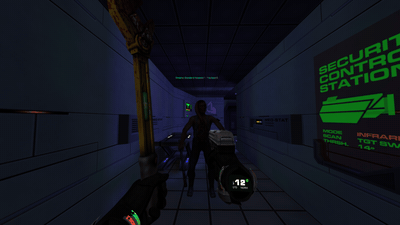
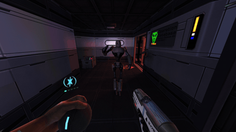
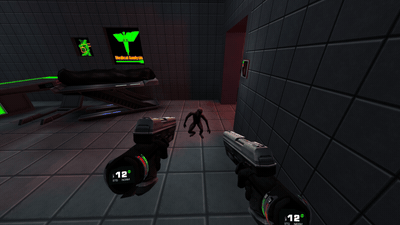
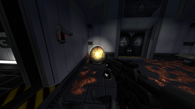
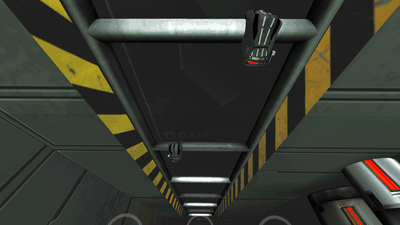
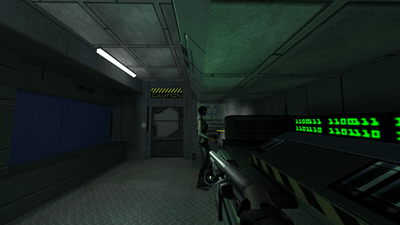
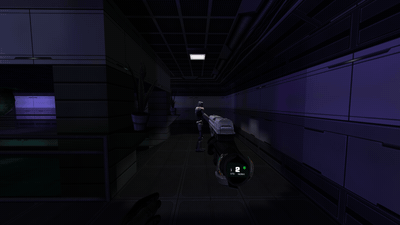

# shock2quest

 

A project to experience System Shock 2 in virtual reality. System Shock 2 is one of my favorite games of all time, and the story and ambience would be great for VR. 

This project is a [game engine recreation](https://en.wikipedia.org/wiki/Game_engine_recreation) of the [Dark engine](https://en.wikipedia.org/wiki/Dark_Engine) - geared towards VR experiences.

You'll need a full retail copy of **System Shock 2: 25th Anniversary Remaster** in order to play - purchase at either [GoG](https://www.gog.com/en/game/system_shockr_2_25th_anniversary_remaster) or [Steam](https://store.steampowered.com/app/866570/). Its upgraded models and textures are what the VR hands and weapons are built against.

The APK does not include retail game data. See the [installation guide](INSTALL.md) for the files to copy from your remaster installation.

> **Status:** This project is in pre-alpha. Expect incomplete features and bugs.
> Save files are not guaranteed to work across releases. Updating may require
> starting a new game.

## Screenshots

 
 
 

## Installation

Download the latest signed Quest APK: [shock2quest.apk](https://github.com/tommy-xr/shock2quest/releases/latest/download/shock2quest.apk),
then follow the [installation guide](INSTALL.md) to sideload it and copy
your remaster game files.

## Further reading

- [Quest player guide](docs/playing.md) — controls, weapons, inventory, and VR interactions.
- [Desktop runtime](runtimes/desktop_runtime/README.md) — running on desktop, keyboard and mouse controls, and simulated VR hands.
- [Development guide](DEVELOPMENT.md) — building from source and developer reference.
- [Development tools](tools/README.md) — Cargo aliases, asset exploration, device tools, and automation.

## License

Some code is ported from [openDarkEngine](https://github.com/volca02/openDarkEngine), so this code is licensed under [GPLv2](https://www.gnu.org/licenses/old-licenses/gpl-2.0.en.html) to comply with that license.

In addition, code in the `engine` folder is agnostic of Shock2, so is dual-licensed under the MIT license.

## Credits

- Demo assets are from [BabylonJS Assets](https://github.com/BabylonJS/Assets).
- VR glove model adapted from Valve's [SteamVR Unity Plugin](https://github.com/ValveSoftware/steamvr_unity_plugin).

## Thanks

There were several projects around the SS2 community, that served as an inspiration, or were used to help understand the internals of the dark engine and file formats, notably:

- [openDarkEngine](https://github.com/volca02/openDarkEngine) by [volca02](https://github.com/volca02)
- [SystemShock2VR](https://github.com/Kernvirus/SystemShock2VR) by [Kernvirus](https://github.com/Kernvirus)

Outside of the system shock/thief community, the work that [Team Beef](https://sidequestvr.com/community/7/team-beef-game-ports) has done in bringing games to VR inspired this project. 

In addition, there were several great Rust libraries that helped bring this project to life:
- [`rapier`](https://github.com/dimforge/rapier) - Physics Library
- [`openxr`](https://github.com/Ralith/openxrs) - Bindings for OpenXR
- [`rodio`](https://github.com/RustAudio/rodio) - Audio Support
- [`serde`](https://serde.rs/) - Serialization / Deserialization (Load/Save)
- [`cgmath`](https://github.com/rustgd/cgmath) - Vector math library
- [`clap`](https://docs.rs/clap/latest/clap/) - Command line parsing
- [`cargo-apk`](https://github.com/rust-mobile/cargo-apk) - easy cross-compiling to android

Finally, thank you to [Nightdive Studios](https://www.nightdivestudios.com/) for keeping these retro games alive, as well as Le Corbeau for the NewDark patches that allowed me to revisit the SS2 universe
