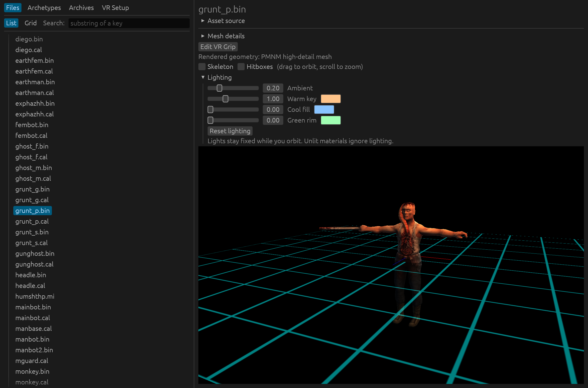
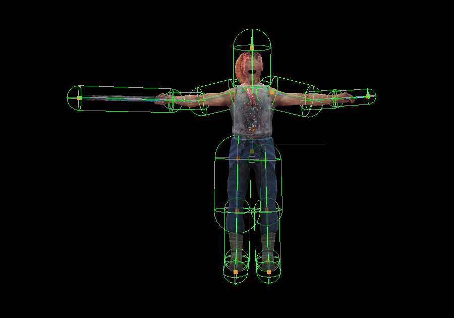
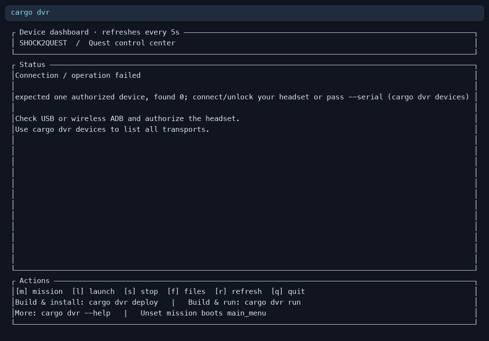
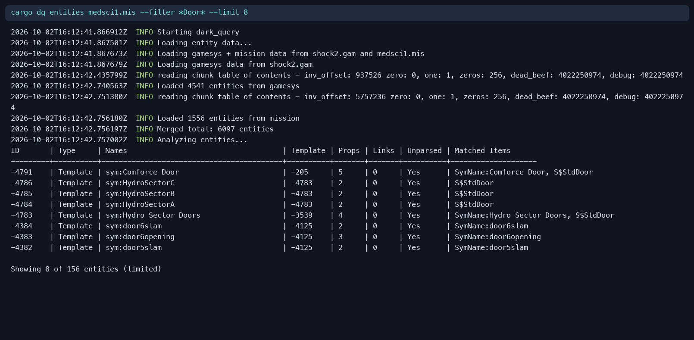
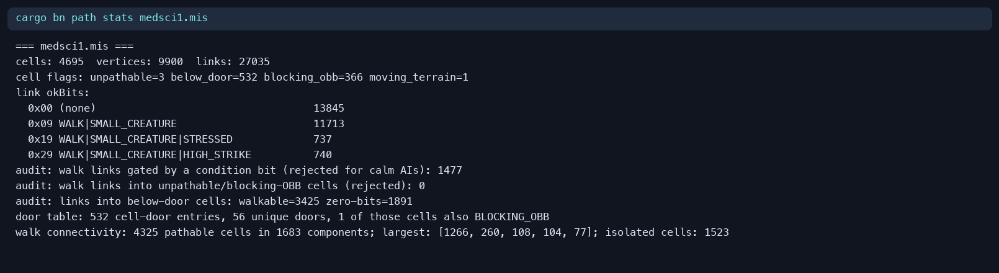
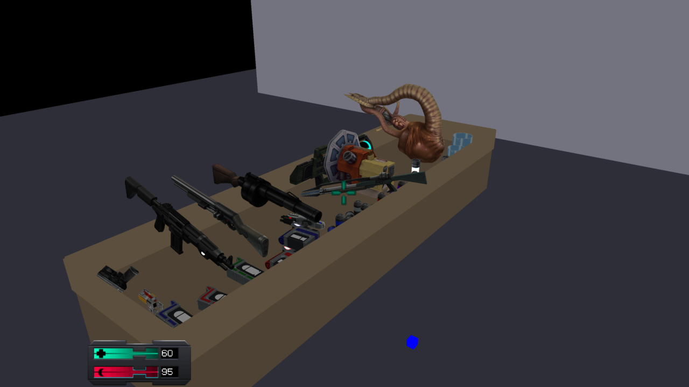
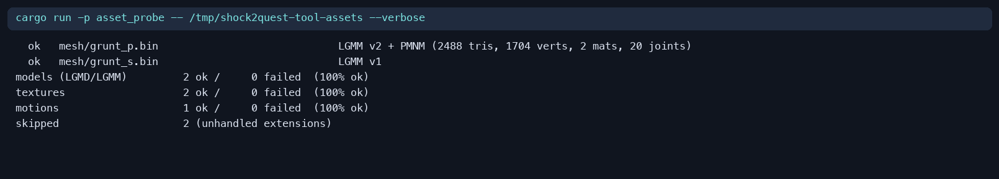
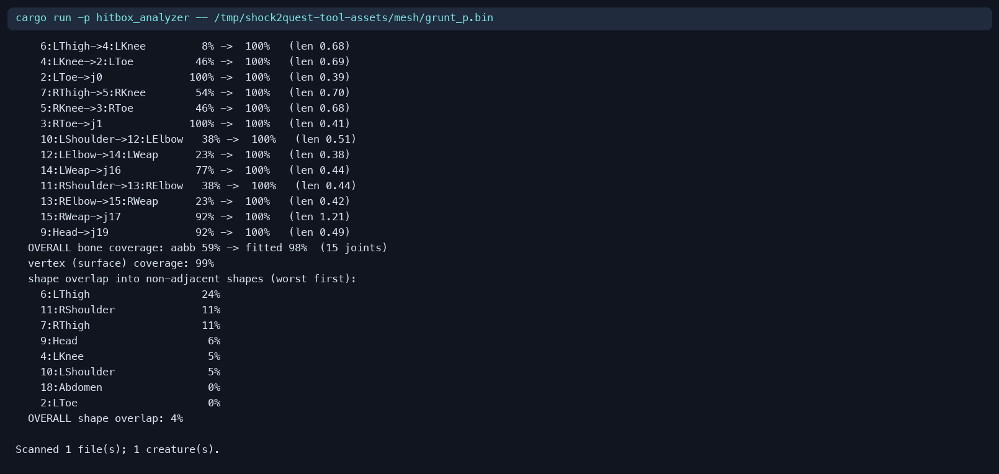

# Development tools

See the [development guide](../DEVELOPMENT.md) for build and game data setup.
Run the commands below from the repository root.

## Cargo aliases


The project includes convenient cargo aliases:
- `cargo dr` - Run desktop runtime (shorthand for `cargo run -p desktop_runtime --`)
- `cargo dvr` - Open the Quest device dashboard ([commands](dark_vr_tool/README.md))
- `cargo dx` - Open the asset explorer, including model previews, archetypes, audio, and VR pose editing (`cargo dx ui`)
- `cargo bn` - Run pathfinding benchmarks and inspect navigation data
- `cargo dq` - Run dark_query CLI tool (shorthand for `cargo run -p dark_query --`)
- `cargo dv` - Run dark_viewer tool (shorthand for `cargo run -p dark_viewer --`)
- `cargo dbgr` - Run the HTTP-controlled debug runtime (used for automation/testing; see [TypeScript SDK](shock2-sdk/README.md) for the TypeScript SDK that drives it)

Example usage:
```bash
cargo dr --vr --experimental physical_held_items  # Run desktop with physical held items
cargo dx ui --archetype Rumbler  # Browse an archetype and its model
cargo dq entities earth.mis --limit 5  # Query entities in mission
cargo dv grunt_p.bin  # View model file
```

## Tool reference

| Tool | Purpose | Example |
| --- | --- | --- |
| `cargo dx` | Browse assets and archetypes; preview models, animations, and audio; author VR grips and belt-card poses | `cargo dx ui --archetype Rumbler` |
| `cargo dv` | Inspect a model, its skeleton, hitboxes, or articulated parts | `cargo dv grunt_p.bin --debug-skeletons` |
| `cargo dvr` | Inspect an attached Quest, deploy builds, and collect device diagnostics | `cargo dvr` |
| `cargo dq` | Query mission entities, template inheritance, motions, and speech | `cargo dq entities earth.mis --limit 5` |
| `cargo bn` | Inspect and benchmark navigation data | `cargo bn path stats medsci1.mis` |
| `cargo dbgr` | Drive the game over HTTP for deterministic testing and captures | `cargo dbgr --mission medsci1.mis` |
| `asset_probe` | Check which extracted models, textures, and motions the parsers can load | `cargo run -p asset_probe -- <asset-directory>` |
| `hitbox_analyzer` | Inspect creature limb collision fit and bone coverage | `cargo run -p hitbox_analyzer -- <mesh.bin>` |

 
 
 
 

`cargo dbgc` is currently a placeholder. Use the [TypeScript SDK](shock2-sdk/README.md)
or HTTP requests to control the debug runtime.

[Back to Shock2Quest](../README.md)
